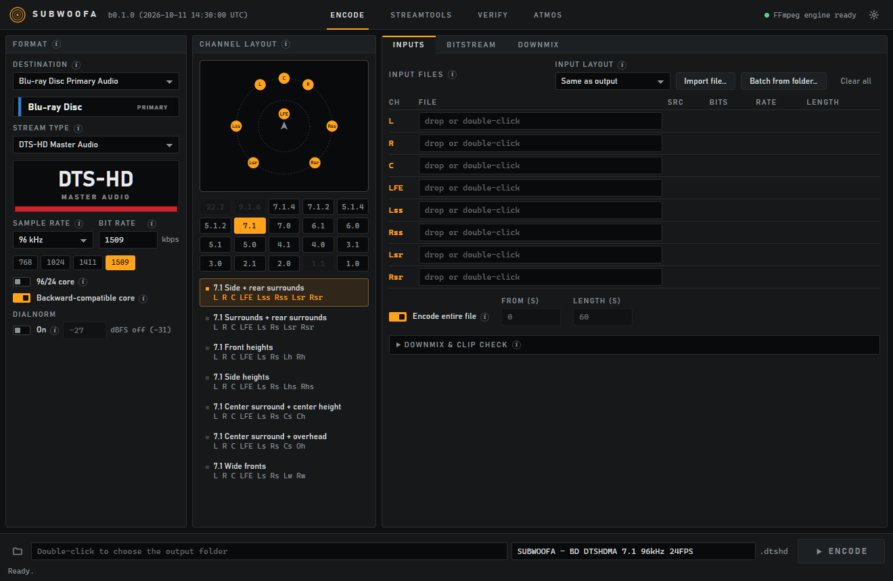

# Subwoofa

An **open-source** multichannel audio encoder with a proper GUI and CLI.

> **Public beta.** Subwoofa is young and the format list is large. Please report anything odd.



Give it a set of mono files (or one multichannel file) from your DAW and it writes the stream your disc, player or
delivery spec asks for: **DTS** (core, ES, 96/24, HD High Resolution, HD Master Audio, Express), **Dolby** (AC-3,
E-AC-3, TrueHD, MLP, and Atmos through your own Dolby Encoding Engine) and **audio files** (WAV, AIFF, CAF, FLAC,
ALAC, TTA, DSD). It also verifies what it writes, and has StreamTools for trimming, splitting and joining streams.

## What it can do

| | |
|---|---|
| **Encode** | 30 channel layouts up to 22.2, Blu-ray / DVD / DTS Music Disc rules built in, lossless and lossy, own encoders written from public specs |
| **Bitstream and Downmix** | timecode, seamless branching, embedded stereo and 5.1 downmixes, clip check, safe trim |
| **StreamTools** | info and bit-rate chart, trim, split, append, replace, re-stripe, add silence |
| **Verify** | structure and checksum check for every stream type, plus a deep mode with a full decode |
| **Atmos** | TrueHD and Dolby Digital Plus Atmos through the Dolby Encoding Engine you supply |
| **Queue** | several encodes at once, progress, cancel, automatic verify |

Every format and its test status: [docs/FORMATS.md](docs/FORMATS.md).

## AI disclaimer (and a Hi from a Human)

Hi, Callum here. 
I am not actually a coder. I thought of a fun project and ran it through Claude Code's Sonnet 5.5 Medium.
All of the code base is from Claude. I gave it inputs and test files and verified this program can actually do what it says on the tin the whole time. 
The "verify" feature is one you should utilize if you use this program.
Subwoofa has its own encoders and works on its own for *most* formats. Dolby Atmos needs the Dolby Encoding Engine (licensed from Dolby), and FFmpeg is only needed to read inputs that aren’t WAV/AIFF. See [docs/ENGINES.md](docs/ENGINES.md).

## Install

Windows 10 or 11, 64-bit.

1. Download the installer (or the portable zip) from the [latest release](../../releases). (Check it against `SHA256SUMS.txt`).
2. Run it. Windows SmartScreen will warn that the app is unsigned, because the project cannot afford a signing
   certificate yet. Choose *More info*, then *Run anyway*.
3. Open **Settings > Engines** and see what is found. Subwoofa works on its own for most formats; some things
   want a tool you provide. [docs/ENGINES.md](docs/ENGINES.md) explains which and why.

macOS and Linux are not yet tested -- get in touch if you can test it.

## Command line

```sh
subwoofa formats
subwoofa encode --stream dtshd-ma --dest bluray-primary --layout 5.1 --auto-import Film_L.wav --engine native -o Film.dtshd
subwoofa verify Film.dtshd --deep
```

Every command prints its version to stderr first, so stdout stays clean for scripts. More in
[docs/USAGE.md](docs/USAGE.md).

## Documentation

[Getting started](docs/GETTING-STARTED.md) · [Engines and tools](docs/ENGINES.md) · [Formats](docs/FORMATS.md) ·
[Atmos](docs/ATMOS.md) · [Command line](docs/USAGE.md) · [Troubleshooting](docs/TROUBLESHOOTING.md) ·
[Legal](docs/LEGAL.md) · [Roadmap](docs/ROADMAP.md)

## Build from source

Rust stable. On Windows either toolchain works; the GNU one needs no Visual Studio (`rustup default stable-x86_64-pc-windows-gnu`).

```sh
cargo build --release -p sw-cli
cd app && npm install && npx tauri build
```

## Legal

Subwoofa is independent software. It is **not affiliated with, endorsed by or certified by DTS, Inc. or Dolby
Laboratories**; "DTS", "Dolby", "TrueHD", "Atmos" and related names are trademarks of their owners. Read
[docs/LEGAL.md](docs/LEGAL.md).

Licensed under the **GNU General Public License v3.0 or later** ([LICENSE](LICENSE)). 
Copyright © Subwoofa contributors. 
Questions and reports: [GitHub issues](../../issues).
